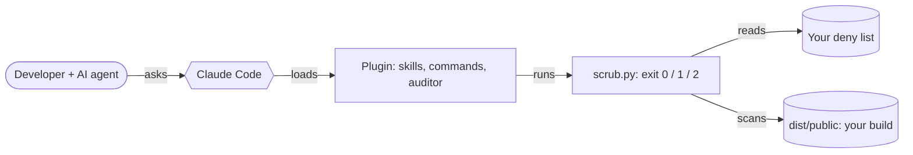

# Agent Ops Kit

A Claude Code plugin for developers who let an AI agent ship code. It adds three skills, two slash commands, one review subagent and a Python scanner that fails a build when personal data or credentials from your deny list are still in it.

It teaches three habits:

1. Say what you checked. No "it's running" without the command output that shows it.
2. Strip your data before you share. The scanner exits nonzero when anything on your deny list is still in a public copy.
3. Build private and public copies from one source, so they cannot drift apart.

## How it works



| Piece | What it does |
|---|---|
| `evidence-gate` skill | Fires before the agent claims something is deployed, running, passing or fixed |
| `scrub-before-share` skill | Fires when something is about to leave the machine: a repo, gist or bug report |
| `two-variant-release` skill | Describes the layout for a private and a public build from one tree |
| `/agent-ops-kit:scrub-check [path]` | Runs the scanner over `path` (default `dist/public`) with `build/denylist.private.json` |
| `/agent-ops-kit:release-public` | Runs your `build/build.py public`, checks the output, then stops. It never publishes. |
| `agent-ops-kit:release-auditor` | Runs the scanner, then looks for what a regex misses: machine paths, fixtures, git history. Returns `SAFE TO SHARE` or `NOT SAFE` with file and line. |

The auditor's no-edit, no-publish rule is in its prompt, not enforced by tool permissions.

## Install

This repo is a plugin, not a marketplace, so load it per session:

```bash
git clone https://github.com/thefiredev-cloud/agent-ops-kit.git
claude --plugin-dir ./agent-ops-kit
# or: claude --plugin-url https://github.com/thefiredev-cloud/agent-ops-kit/archive/refs/heads/main.zip
```

Needs Claude Code with plugin support (loaded and listed on 2.1.296) and Python 3.9+ for the scanner.

You provide a deny list (copy `scripts/denylist.example.json` to `build/denylist.private.json` and keep it out of git) and, for `/release-public`, a `build/build.py`.

## The scanner

```bash
python3 scripts/scrub.py --denylist my-denylist.json ./dist/public                 # everything
python3 scripts/scrub.py --denylist my-denylist.json --groups secret ./dist/internal  # credentials only
```

A deny list is JSON with a `patterns` array; each entry has `name`, `regex`, `group` (`secret` or `identity`), optional `flags` and `hint`. `secret` hits fail every build. `identity` hits (names, emails, hostnames, home paths) fail only public builds. The engine ships no patterns, and an empty list refuses to run. Matches are masked in the output.

Exit codes: `0` clean, `1` findings or a bad deny list or target, `2` bad arguments. Files over 8 MiB and unreadable files count as findings, so nothing passes half-read. It skips `.git`, `node_modules`, `.venv` and similar folders.

Test it before you trust it: plant a deny string, confirm it fails, remove it, confirm it passes.

## Status and limits

- Version 0.1.0. No automated test suite. Not in a marketplace.
- It finds only what your deny list describes. A new hostname passes.
- It does not check git history (`git log -p -S '<string>'` does), does not publish, and cannot undo a push.

More detail: [docs/ARCHITECTURE.md](docs/ARCHITECTURE.md).

## License

All rights reserved. See [LICENSE](LICENSE). Contact: [tanner@kodros.ai](mailto:tanner@kodros.ai). Security policy: [SECURITY.md](SECURITY.md).
