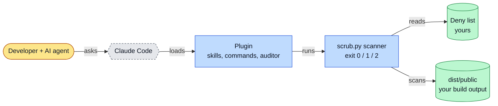
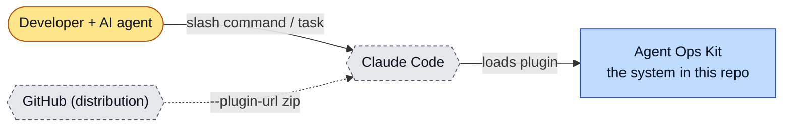
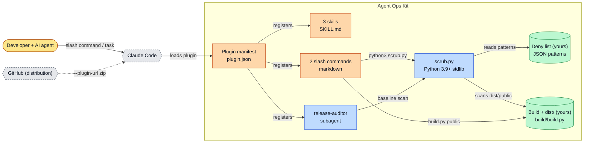
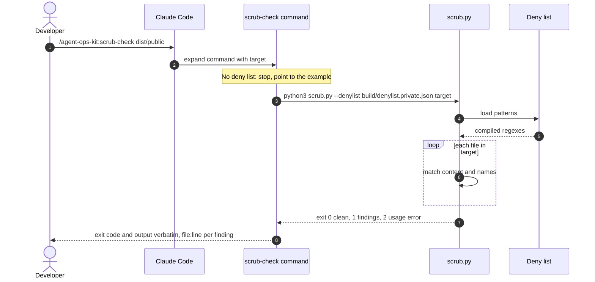
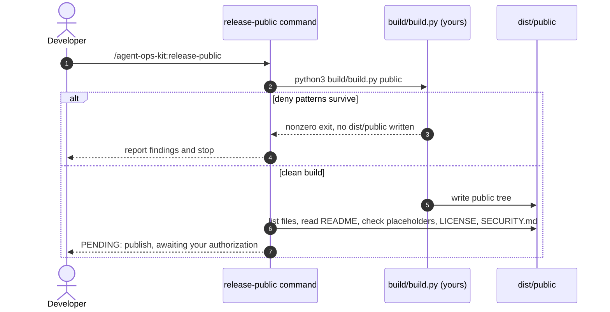
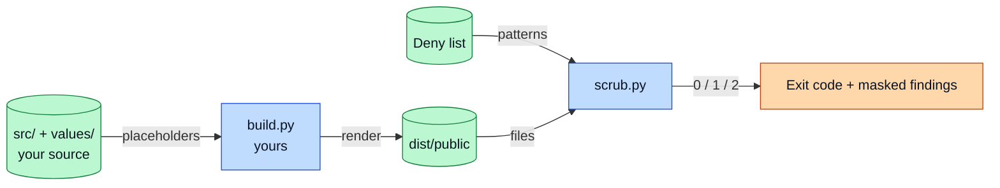
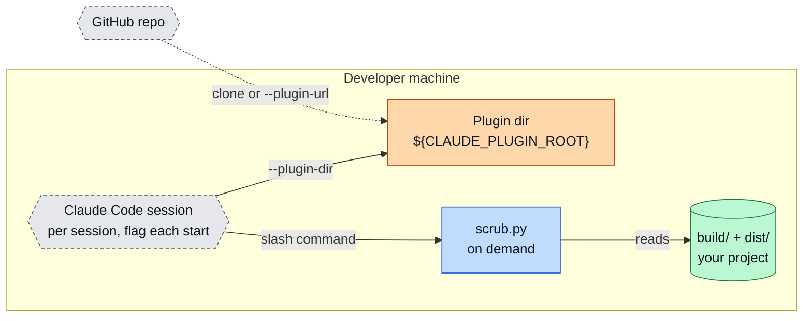
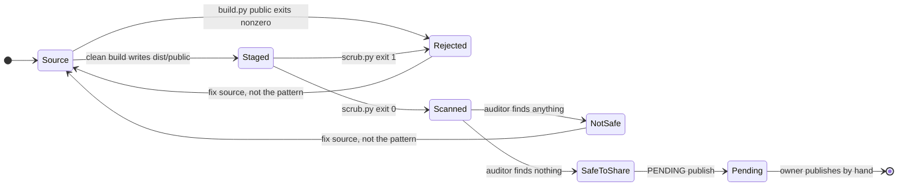

# Agent Ops Kit: architecture

<!-- arch-kit:generated -->

> Whiteboard-level structure: what systems exist, what they talk to, and when they run. Evidence-backed; every box below maps to a path listed in [Evidence](#10-evidence).
> Generated by the ArchDocs kit from repo commit `bb258eec51`. Diagram sources: [`architecture/*.mmd`](architecture/). Hi-res renders sit next to each source.

## 1. Purpose

Agent Ops Kit is a Claude Code plugin for developers who let an AI agent ship code. It bundles three skills, two slash commands, one read-only review subagent and a standard-library Python scanner (`scripts/scrub.py`). The scanner fails the run when text on your deny list, such as a credential or a name, survives into a build you are about to share. The repo ships no build script and no deny list of its own: you supply `build/build.py` and `build/denylist.private.json`.

## 2. Whiteboard view

Six boxes. The agent never decides what is safe: the scanner and your deny list do, and publishing stays with the human.

Hi-res: [SVG](architecture/whiteboard.svg) · [PNG 3x](architecture/whiteboard@3x.png) · [dark SVG](architecture/whiteboard.dark.svg) · [dark PNG 3x](architecture/whiteboard.dark@3x.png)

Explorable version (Archify, standalone HTML, download and open locally): [`architecture/agent-ops-kit.archify.html`](architecture/agent-ops-kit.archify.html)

## 3. System context (C4 level 1)

Who and what touches the system from outside.

Hi-res: [SVG](architecture/context.svg) · [PNG 3x](architecture/context@3x.png)

## 4. Containers and components (C4 level 2)

The parts that run or hold data inside the repo's system boundary.

Hi-res: [SVG](architecture/containers.svg) · [PNG 3x](architecture/containers@3x.png)

| Container | Kind | Tech | What it does | Evidence |
|---|---|---|---|---|
| Plugin manifest | doc | plugin.json | Declares skills, commands and the auditor agent that Claude Code loads. | [`.claude-plugin/plugin.json#L24-L28`](../.claude-plugin/plugin.json#L24-L28) |
| 3 skills | doc | SKILL.md | evidence-gate, scrub-before-share, two-variant-release: load themselves when the work calls for them. | [`skills/evidence-gate/SKILL.md`](../skills/evidence-gate/SKILL.md), [`skills/scrub-before-share/SKILL.md`](../skills/scrub-before-share/SKILL.md), [`skills/two-variant-release/SKILL.md`](../skills/two-variant-release/SKILL.md) |
| 2 slash commands | doc | markdown | /scrub-check runs the scanner; /release-public runs your build script and checks the output. Neither publishes. | [`commands/scrub-check.md#L16-L21`](../commands/scrub-check.md#L16-L21), [`commands/release-public.md#L9-L17`](../commands/release-public.md#L9-L17) |
| release-auditor | app | subagent | Runs the scanner first, then hunts what a regex cannot catch. Returns SAFE TO SHARE or NOT SAFE. Read-only by instruction. | [`agents/release-auditor.md#L20-L25`](../agents/release-auditor.md#L20-L25), [`agents/release-auditor.md#L66-L72`](../agents/release-auditor.md#L66-L72) |
| scrub.py | app | Python 3.9+ stdlib | Scans file contents and file names against the deny list. Exit 0 clean, 1 findings, 2 bad arguments. | [`scripts/scrub.py#L153-L191`](../scripts/scrub.py#L153-L191) |
| Deny list (yours) | store | JSON patterns | build/denylist.private.json. Groups: secret (fatal anywhere) and identity (fatal in public builds). Example in scripts/denylist.example.json. | [`scripts/denylist.example.json`](../scripts/denylist.example.json), [`scripts/scrub.py#L43-L77`](../scripts/scrub.py#L43-L77) |
| Build + dist/ (yours) | store | build/build.py | Your private and public builds rendered from one source tree. The kit only describes the layout. | [`skills/two-variant-release/SKILL.md`](../skills/two-variant-release/SKILL.md), [`commands/release-public.md#L9-L17`](../commands/release-public.md#L9-L17) |

## 5. Key runtime sequences

### 5.1 /scrub-check before sharing a build

The command refuses to run without a deny list and reports the exit code verbatim.

Hi-res: [SVG](architecture/sequence-1.svg) · [PNG 3x](architecture/sequence-1@3x.png)

### 5.2 /release-public stops before publishing

Hi-res: [SVG](architecture/sequence-2.svg) · [PNG 3x](architecture/sequence-2@3x.png)

## 6. Data flow and stores

Patterns flow from your deny list into the scanner; findings flow out as an exit code plus masked matches. Nothing is written back.

Hi-res: [SVG](architecture/dataflow.svg) · [PNG 3x](architecture/dataflow@3x.png)

| Store | What it holds | Written by | Evidence |
|---|---|---|---|
| Deny list JSON | Regex patterns with a group (secret or identity), flags and a fix hint. An empty list makes the scanner refuse to run. | You (never committed) | [`scripts/scrub.py#L52-L56`](../scripts/scrub.py#L52-L56), [`scripts/denylist.example.json`](../scripts/denylist.example.json) |
| dist/internal, dist/public | Private and public renderings of one source tree. | Your build/build.py | [`skills/two-variant-release/SKILL.md`](../skills/two-variant-release/SKILL.md) |

## 7. Deployment and runtime topology

Nothing is hosted. The plugin is loaded by path or URL for one session at a time and the scanner runs on demand.

Hi-res: [SVG](architecture/deployment.svg) · [PNG 3x](architecture/deployment@3x.png)

| What | Where | Runs when | Trigger / port | Evidence |
|---|---|---|---|---|
| scrub.py | Developer machine | On demand only: /scrub-check, release-auditor, or by hand | no timer, no CI, no daemon | [`commands/scrub-check.md#L16-L21`](../commands/scrub-check.md#L16-L21) |
| Plugin load | Claude Code | Every session, flag must be passed each start | --plugin-dir or --plugin-url | [`README.md#L17-L28`](../README.md#L17-L28) |

## 8. Failure modes and how to see them

| Failure | What the user sees | How to see it | Evidence |
|---|---|---|---|
| Deny list missing, invalid JSON, or empty | Scan refuses to run; never reports clean | stderr line starting `scrub:`, exit 1 | [`scripts/scrub.py#L43-L56`](../scripts/scrub.py#L43-L56) |
| File larger than 8 MiB | Reported as an `oversized` finding, run fails | finding with pattern `oversized` | [`scripts/scrub.py#L40`](../scripts/scrub.py#L40), [`scripts/scrub.py#L132-L136`](../scripts/scrub.py#L132-L136) |
| New hostname or alias not on the list | Passes a scan it should fail | Not visible to the scanner. The auditor's manual pass and a planted-string test catch it | [`README.md#L115`](../README.md#L115), [`README.md#L117-L119`](../README.md#L117-L119) |
| Build leaves deny patterns in the output | No dist/public is written | nonzero exit from build.py public | [`commands/release-public.md#L16-L17`](../commands/release-public.md#L16-L17) |
| Installed with /plugin install | Does not work: the repo has no marketplace.json | Load by `--plugin-dir` or `--plugin-url` instead | [`README.md#L17`](../README.md#L17) |

## 9. State machine

The life of a public build candidate. Only the owner moves it out of PENDING.

Hi-res: [SVG](architecture/state.svg) · [PNG 3x](architecture/state@3x.png)

## 10. Evidence

Every path below exists at the pinned commit; links are relative to `docs/`.

| Path | Why it matters |
|---|---|
| [`.claude-plugin/plugin.json#L24-L28`](../.claude-plugin/plugin.json#L24-L28) | Manifest: skills, commands and the release-auditor agent are what Claude Code loads. |
| [`scripts/scrub.py#L153-L191`](../scripts/scrub.py#L153-L191) | Scanner entry point: arguments, exit codes. |
| [`scripts/scrub.py#L43-L77`](../scripts/scrub.py#L43-L77) | Deny list loading and the refusal to run with no patterns. |
| [`scripts/scrub.py#L35-L40`](../scripts/scrub.py#L35-L40) | Skipped directories and the 8 MiB scan cap. |
| [`commands/scrub-check.md`](../commands/scrub-check.md) | Runs the scanner through ${CLAUDE_PLUGIN_ROOT} and reports the exit code verbatim. |
| [`commands/release-public.md`](../commands/release-public.md) | Runs the user's build, checks output, stops before publishing. |
| [`agents/release-auditor.md`](../agents/release-auditor.md) | Scanner first, then manual checks; read-only by instruction. |
| [`skills/two-variant-release/SKILL.md`](../skills/two-variant-release/SKILL.md) | The layout the user's build script must follow. |
| [`README.md`](../README.md) | Install by path or URL, limits, what the kit does not do. |

Collected mechanically by the kit ([`architecture/facts.json`](architecture/facts.json), not hand-edited):

- entry points: `scripts`, `python-script-main`
- external hosts seen in source: `github.com`, `json.schemastore.org`, `meshvault.ai`

Graphify (local AST, no LLM) read this repo: 79 nodes, 81 edges, 10 communities. Most connected: `Agent Ops Kit` (8), `load_patterns()` (6), `main()` (6), `Evidence gate` (6), `Scrub before share` (6).

- Report: [`architecture/graphify/GRAPH_REPORT.md`](architecture/graphify/GRAPH_REPORT.md)
- Interactive graph: [`architecture/graphify/graph.html`](architecture/graphify/graph.html) (69 KB, download and open locally)
